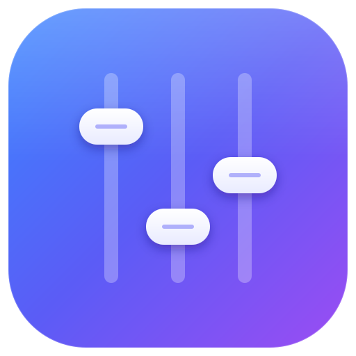
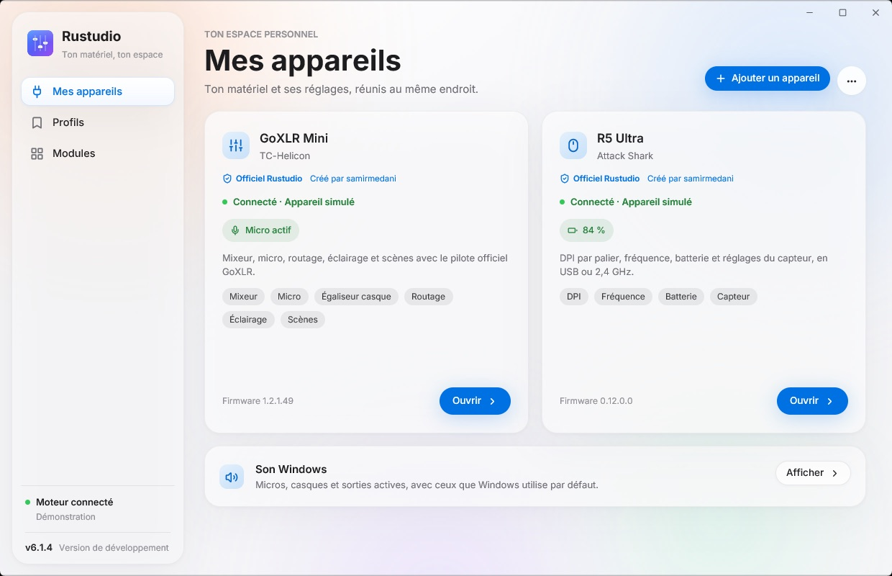

<p align="center">
  
</p>

<h1 align="center">Rustudio</h1>

<p align="center">
  <strong>Tes périphériques Windows, au même endroit.</strong><br>
  Une application libre écrite en Rust, avec des modules pour détecter et régler le matériel de ton bureau.
</p>

<p align="center">
  <a href="https://github.com/samirmedani/rustudio/releases/latest/download/Rustudio-Setup.exe"></a>
</p>

<p align="center">
  <a href="https://github.com/samirmedani/rustudio/releases/latest"></a>
  <a href="https://github.com/samirmedani/rustudio/actions/workflows/ci.yml"></a>
  <a href="LICENSE"></a>
  
</p>

<p align="center">
  <a href="#compatibilité">Appareils compatibles</a> ·
  <a href="#installer">Installation</a> ·
  <a href="#contribuer">Contribuer</a> ·
  <a href="docs/START-HERE.en.md">English</a>
</p>

## Tes appareils, tes modules

Rustudio réunit les réglages de tes périphériques dans **Mes appareils**. Branche un appareil pris en charge : il apparaît automatiquement, avec son état et ses réglages. Débranche-le : sa carte et tes préférences restent disponibles.

Chaque module apporte les contrôles propres à son matériel. Dans **Modules**, tu peux voir ce qui est livré et les appareils dont la prise en charge reste à créer. Les nouveaux modules peuvent être proposés par le mainteneur ou par la communauté.

<p align="center">
  
  <br><sub>Capture réalisée avec des périphériques simulés.</sub>
</p>

## Compatibilité

| Module livré | Ce que tu peux régler | Compatibilité |
| --- | --- | --- |
| [Attack Shark R5 Ultra](docs/R5-ULTRA.md) | DPI par axe, fréquence, veille et capteur ; état de la batterie | Récepteur 2,4 GHz testé sur la souris ; USB testé en simulation |
| [TC-Helicon GoXLR Mini](docs/GOXLR-MINI.md) | Mixeur, micro, routage, éclairage, scènes, égaliseur casque et diagnostic audio | Pilote officiel TC-Helicon ; firmware 1.2.x testé, 1.3 pris en charge |

**Tu ne vois pas ton appareil ?** [Demande un module](https://github.com/samirmedani/rustudio/issues/new?template=appareil.yml). Indique la marque, le modèle, le mode de connexion et le réglage qui te serait le plus utile. Une fiche « À contribuer » dans le [catalogue](library/index.json) indique une demande, pas une compatibilité.

## Installer

1. Télécharge [Rustudio-Setup.exe](https://github.com/samirmedani/rustudio/releases/latest/download/Rustudio-Setup.exe) et lance l’installation.
2. Ouvre **Mes appareils** et branche ton matériel. Les prérequis propres à un module sont indiqués dans le tableau.
3. Ouvre la carte de l’appareil pour le régler. Tu retrouves Rustudio près de l’horloge Windows.

Windows 10 ou 11, 64 bits, avec Microsoft Edge WebView2. Pour désinstaller Rustudio, ouvre **Paramètres → Applications**. Tes réglages restent sur ton PC.

## Mises à jour, historique et retour arrière

Rustudio te propose les nouvelles [versions GitHub](https://github.com/samirmedani/rustudio/releases). L’installation commence uniquement quand tu la confirmes. L’application vérifie la taille, l’empreinte SHA-256 et le contenu de l’archive. Elle rétablit la version précédente si la nouvelle ne répond pas.

Clique sur le numéro de version pour lire l’historique et, si nécessaire, revenir à une version publiée compatible. Les changements sont détaillés dans le [journal des versions](CHANGELOG.md).

## Aide et confidentialité

**Pas de compte ni de télémétrie.** Tes réglages restent sur ton PC. Rustudio contacte GitHub pour les versions et les téléchargements que tu demandes. Dans **⋯ → Aide et retours**, tu peux copier un diagnostic anonymisé et le relire avant de le partager.

[Signaler un bug](https://github.com/samirmedani/rustudio/issues/new?template=bug.yml) · [Poser une question ou proposer une idée](https://github.com/samirmedani/rustudio/discussions) · [Signaler une faille en privé](SECURITY.md)

## Contribuer

Tu peux **demander un appareil, tester un module sur ton matériel, écrire du code ou améliorer la documentation**. Un module communautaire garde le crédit de son créateur. Après revue et validation, il est intégré à une version de Rustudio. Le catalogue affiche les modules livrés et les demandes ; il n’installe pas de code tiers à la volée.

- [Guide de contribution](CONTRIBUTING.md) : démarrer et préparer une pull request.
- [Ajouter un appareil](docs/MODULES.md) : protocole, simulateur, intégration et interface.
- [Modules communautaires](docs/COMMUNITY.md) : attribution, revue et publication.

## Développer

Le service Rust gère le matériel et expose une API locale. L’application Windows affiche les appareils et leurs contrôles. Le registre des modules décrit les capacités et les écrans disponibles ; chaque module adapte son protocole au moteur.

```sh
git clone https://github.com/samirmedani/rustudio.git
cd rustudio
cargo run -p rustudio-engine -- run --child --simulate --port 14566
```

Ouvre [l’interface du simulateur](http://127.0.0.1:14566/). Tu peux tester les modules fournis sans posséder le matériel. Lance `scripts/check.sh` avant une pull request.

Rustudio est libre sous [licence MIT](LICENSE). Les dépendances et crédits sont listés dans les [mentions tierces](THIRD-PARTY-NOTICES.md).
