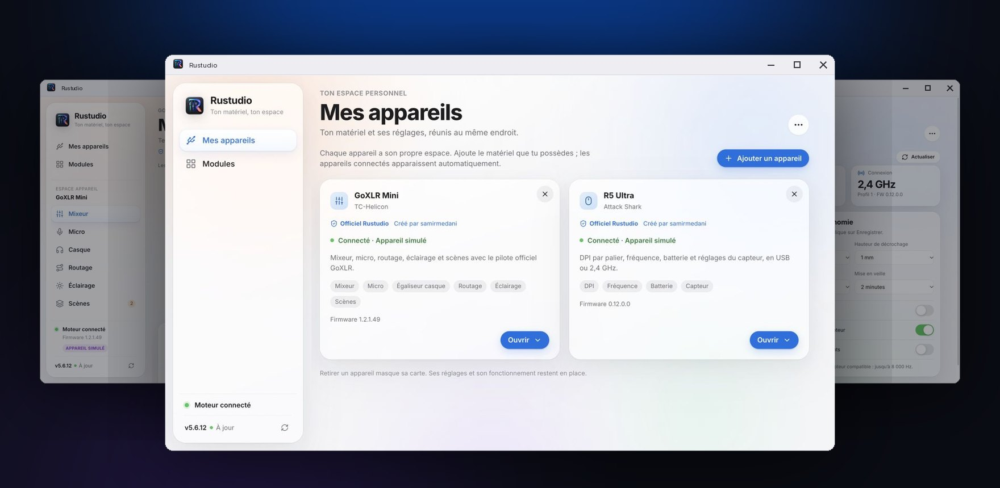
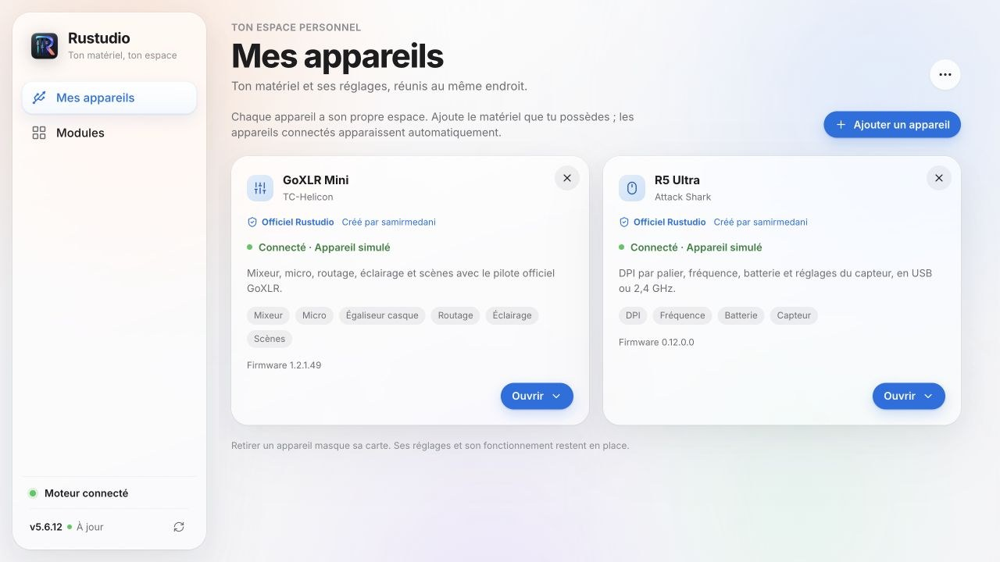
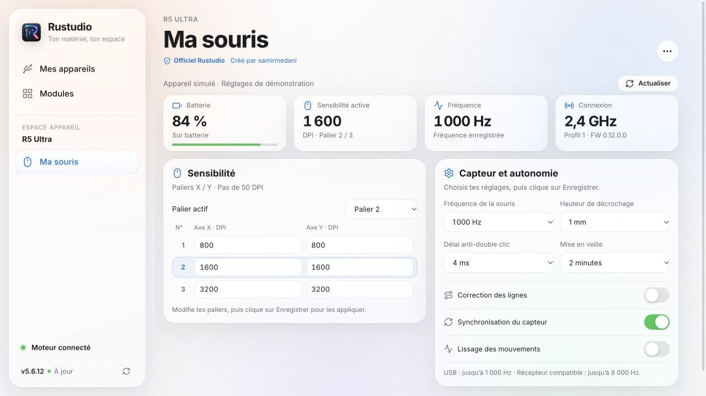
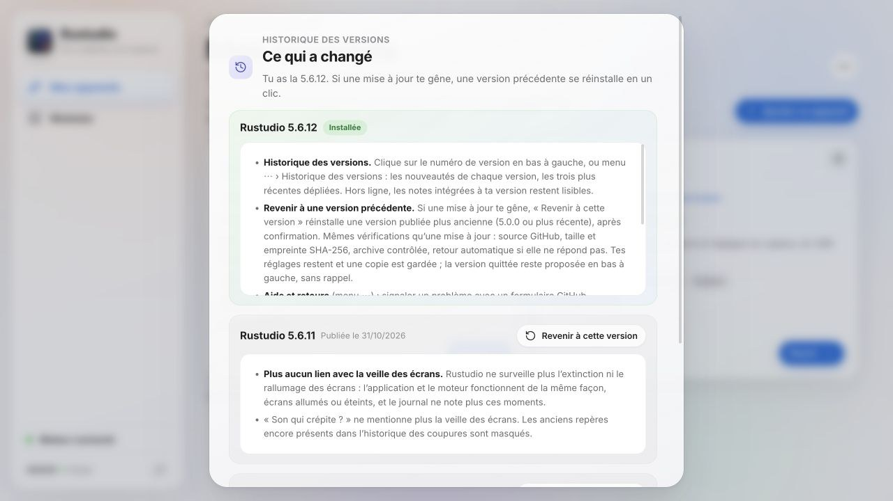
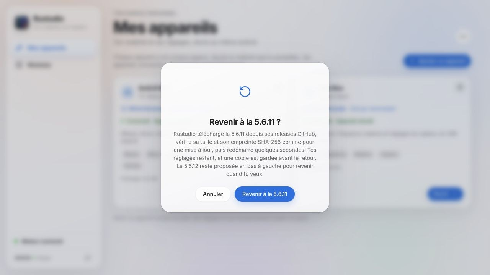
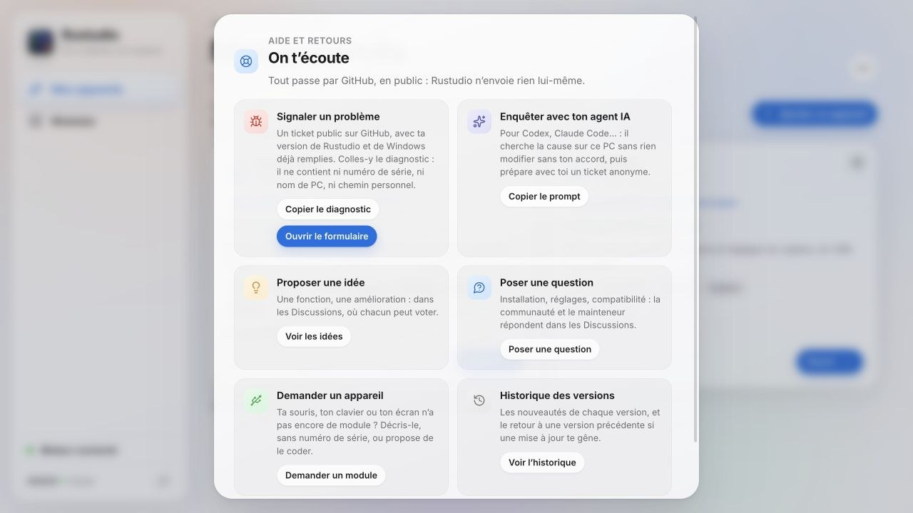
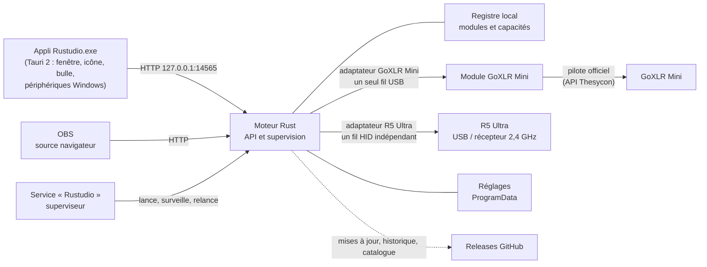

<p align="center">
  
</p>

<p align="center">
  
</p>

<h1 align="center">Rustudio</h1>

<p align="center">
  <b>Ton matériel, dans un même espace.</b><br>
  Le logiciel libre qui pilote ton matériel de bureau sous Windows, écrit en Rust et organisé en modules :<br>
  GoXLR Mini et souris Attack Shark R5 Ultra.
</p>

<p align="center">
  <a href="https://github.com/samirmedani/rustudio/releases/latest"></a>
  <a href="https://github.com/samirmedani/rustudio/actions/workflows/ci.yml"></a>
  <a href="LICENSE"></a>
  
  
  <a href="#téléchargements"></a>
  <a href="https://github.com/samirmedani/rustudio/stargazers"></a>
</p>

<p align="center">
  <a href="https://github.com/samirmedani/rustudio/releases/latest/download/Rustudio-Setup.exe"></a>
</p>

<p align="center">
  <a href="#installer"><b>Installer</b></a> ·
  <a href="#fonctionnalités"><b>Fonctionnalités</b></a> ·
  <a href="#mises-à-jour-historique-et-retour-arrière"><b>Mises à jour</b></a> ·
  <a href="#aide-et-retours"><b>Aide</b></a> ·
  <a href="#confidentialité"><b>Confidentialité</b></a> ·
  <a href="#contribuer"><b>Contribuer</b></a>
</p>

> *English: Rustudio is an open-source controller for your desk gear on Windows, written in Rust and organised in
> device modules. It drives the TC-Helicon GoXLR Mini through the official driver only (mixer, natural voice with
> optional processing, routing, lighting, scenes, headphone EQ, echo check, OBS overlay) and the Attack Shark R5 Ultra
> mouse (DPI stages, polling rate, battery, sensor). Opt-in verified updates with version history and rollback, an
> anonymised bug report, no account, no telemetry. Anyone can add a device module through a reviewed pull request.
> French interface.*

<p align="center">
  
</p>

## Comment ça marche

<p align="center">
  
</p>

1. **Installe** [Rustudio-Setup.exe](https://github.com/samirmedani/rustudio/releases/latest/download/Rustudio-Setup.exe) :
   un seul fichier, qui installe le moteur (un service Windows), l’appli et son icône près de l’horloge.
2. **Branche ton matériel** : chaque appareil pris en charge apparaît dans **Mes appareils**, avec son état en direct.
   Débranché, il garde sa carte et ses réglages.
3. **Règle tout au même endroit** : un clic sur la carte ouvre l’espace de l’appareil. Tes réglages sont gardés sur
   ton PC et réappliqués à chaque connexion.

Le moteur tourne dès le démarrage de Windows et se relance seul s’il a un souci. L’appli ajoute ce qui demande ta
session : la fenêtre, l’icône d’état, la bulle à l’écran et les périphériques audio par défaut de Windows.

## Fonctionnalités

<table>
  <tr>
    <td colspan="2" align="center">
      
      <br><b>Mes appareils</b> · une carte par appareil, son état en direct, ses réglages à un clic.
    </td>
  </tr>
  <tr>
    <td width="50%" align="center">
      
      <br><b>Mixeur</b> · les quatre faders et toutes les voies, suivis pendant le mouvement des faders physiques.
    </td>
    <td width="50%" align="center">
      
      <br><b>Micro</b> · ta voix naturelle par défaut ; « Régler ma voix » cale le gain en 20 secondes.
    </td>
  </tr>
  <tr>
    <td width="50%" align="center">
      
      <br><b>Routage</b> · qui entend quoi : toi, ton stream, Discord, la VOD, les enceintes.
    </td>
    <td width="50%" align="center">
      
      <br><b>Casque</b> · correction de 21 casques (AutoEq) et styles sur 10 bandes, par Equalizer APO.
    </td>
  </tr>
  <tr>
    <td width="50%" align="center">
      
      <br><b>Scènes</b> · Streaming, Gaming, Podcast… en un clic, ou toutes seules quand une appli s’ouvre.
    </td>
    <td width="50%" align="center">
      
      <br><b>Éclairage</b> · thèmes, couleurs par bouton, barres des faders et animations.
    </td>
  </tr>
  <tr>
    <td colspan="2" align="center">
      
      <br><b>Ma souris</b> · batterie, paliers DPI X/Y, fréquence, veille et capteur de la R5 Ultra, d’un coup d’œil.
    </td>
  </tr>
</table>

<sub>Toutes les captures de ce README sont faites avec les appareils simulés de Rustudio : aucune donnée réelle n’y figure.</sub>

### Ta GoXLR Mini, sans GoXLR Utility

- **Pilote officiel seulement** : Rustudio parle au pilote de TC-Helicon et reprend l’appareil dès qu’il est
  rebranché. Ferme GoXLR Utility ou l’appli officielle : deux logiciels ne peuvent pas piloter la GoXLR en même temps.
- **Voix naturelle par défaut** : égaliseur, noise gate, compresseur et de-esser ont chacun leur interrupteur. Aucun
  traitement ni retour micro ne s’allume sans ton choix. **« Régler ma voix »** trouve ton micro (48 V compris) et
  cale le gain ; **« M’écouter »** enregistre ta voix et te la fait réécouter.
- **Couper d’une seule sortie** : chaque bouton mute a son mode (partout, stream, Discord, casque, enceintes).
  Appui long : coupé partout, le bouton clignote.
- **Faders physiques suivis** pendant leur mouvement, sans renvoyer d’anciennes valeurs au matériel. La Mini n’est
  pas motorisée : un réglage à l’écran change le volume, pas la position de sa poignée ; le prochain mouvement
  physique reprend la main.
- **VOD sans musique** : la VOD reçoit le stream sans la musique, contre les réclamations de droits d’auteur.
- **Anti-écho** : tout ce qui peut faire entendre une voix en double est vérifié au même endroit, avec une correction
  en un clic et un vrai test (trois bips joués dans Discord, ton micro écouté, écho mesuré).
- **Son qui crépite ?** Rustudio relit chaque seconde le compteur du pilote qui note chaque milliseconde de son perdue
  sur l’USB : les coupures des dernières 24 heures s’affichent à la seconde près, avec les programmes que Windows
  lançait à ce moment-là. Un test complet écoute aussi chaque voie et la saturation, et indique le port USB à
  préférer. Comment ces chiffres sont lus : [docs/DIAGNOSTIC.md](docs/DIAGNOSTIC.md).
- **Incrustation OBS** : « Micro coupé » à l’écran du stream (`http://127.0.0.1:14565/overlay`).
- **Appli Windows** : icône d’état près de l’horloge (rouge : micro coupé), bulle à l’écran quand le micro change,
  sans jamais prendre le focus, menu rapide, démarrage avec Windows.

<p align="center">
  
</p>

### Ta souris R5 Ultra

- Jusqu’à six paliers DPI, axes X et Y séparés, et choix du palier actif.
- Fréquence, batterie, hauteur de décrochage, délai anti-double clic, veille et options du capteur.
- Tes changements forment un brouillon : rien ne part vers la souris avant **Enregistrer**, puis tout est relu.
- Un fil HID indépendant de l’audio. En veille, la souris est indiquée « En veille » avec ses dernières valeurs,
  relues dès qu’elle bouge.

Les DPI, la fréquence et le délai anti-double clic sont vérifiés sur la vraie souris en 2,4 GHz ; le transport USB
est testé en simulation. Bluetooth, macros et remappage des boutons ne sont pas pris en charge. Détails :
[docs/R5-ULTRA.md](docs/R5-ULTRA.md).

### Des modules ouverts

<p align="center">
  
</p>

**Modules** présente le catalogue : les modules livrés et les appareils pour lesquels tu peux contribuer. Les modules
sont compilés dans l’application : aucun code du catalogue n’est téléchargé ni installé à la volée. Les modules
officiels indiquent leur créateur ; les modules communautaires gardent leur attribution et passent par une
[pull request analysée et validée](docs/COMMUNITY.md) avant d’apparaître dans une version publiée.

## Mises à jour, historique et retour arrière

<table>
  <tr>
    <td width="50%" align="center">
      
      <br><b>Historique des versions</b> · un clic sur le numéro de version, en bas à gauche.
    </td>
    <td width="50%" align="center">
      
      <br><b>Revenir à une version précédente</b> · toujours après confirmation.
    </td>
  </tr>
</table>

Rustudio regarde les releases de ce dépôt 5 secondes après le démarrage, puis toutes les 6 heures. Quand une version
sort, **« Mise à jour proposée »** apparaît en bas à gauche : tu lis les nouveautés, y compris celles des versions
sautées, puis tu confirmes. **Rien ne s’installe sans ton clic.** « Mettre à jour maintenant » :

1. télécharge `Rustudio.zip` **uniquement** depuis les releases de ce dépôt (chaque redirection doit rester chez GitHub) ;
2. compare sa taille et son empreinte **SHA-256** à celles annoncées par GitHub, et vérifie l’archive ;
3. met la version en place de côté, installe la nouvelle, redémarre le service puis l’appli ;
4. si la nouvelle version ne répond pas, **remet l’ancienne** toute seule.

**Historique des versions** (numéro de version en bas à gauche, ou menu ⋯) : les nouveautés de chaque version, les
trois plus récentes dépliées. Hors ligne, les notes intégrées à ta version restent lisibles.

**Revenir à une version précédente** : une mise à jour te gêne ? « Revenir à cette version » réinstalle une version
publiée plus ancienne (5.0.0 ou plus récente), après confirmation et avec exactement les mêmes vérifications. Tes
réglages restent, une copie est gardée dans `C:\ProgramData\Rustudio\backups`, et la version quittée reste proposée
en bas à gauche, sans rappel, pour y revenir quand tu veux.

Toutes les versions : [Releases](https://github.com/samirmedani/rustudio/releases) ; ce qui change à chacune :
[CHANGELOG.md](CHANGELOG.md).

## Aide et retours

<p align="center">
  
</p>

Dans Rustudio, menu **⋯ › Aide et retours** :

- **Signaler un problème** ouvre le [formulaire de bug](https://github.com/samirmedani/rustudio/issues/new?template=bug.yml)
  avec ta version de Rustudio et de Windows déjà remplies. **Copier le diagnostic** donne un rapport à coller dans le
  ticket : versions, état des appareils, de la connexion, des mises à jour et des coupures USB, dernières lignes du
  journal. Il ne contient ni numéro de série, ni nom de PC ou d’utilisateur, ni chemin personnel, ni adresse IP.
- **Enquêter avec ton agent IA** copie un prompt pour Codex, Claude Code ou un autre agent : où regarder sur ce PC, ce
  qu’il ne doit jamais modifier, comment trouver la cause, puis comment préparer avec toi un ticket anonyme, publié
  seulement avec ton accord.
- **Proposer une idée** et **Poser une question** ouvrent les [Discussions](https://github.com/samirmedani/rustudio/discussions),
  où chacun peut voter et répondre.
- **Demander un appareil** ouvre le formulaire [Nouvel appareil](https://github.com/samirmedani/rustudio/issues/new?template=appareil.yml).

Une faille de sécurité ? Jamais dans un ticket public : voir [SECURITY.md](SECURITY.md).

## Confidentialité

- 🚫 **Pas de serveur Rustudio** : tout tourne sur ton PC.
- 👤 **Pas de compte**, pas d’inscription.
- 📵 **Pas de télémétrie** : ni statistiques ni journal envoyés. Rustudio ne contacte que GitHub, sans clé ni
  cookie : la dernière release publiée, la liste des releases quand tu ouvres l’historique, le catalogue de modules,
  et le téléchargement d’une version que tu as acceptée.
- 🧾 **Diagnostic anonyme, jamais envoyé** : tu le copies, tu le relis, tu le colles toi-même.
- 💻 **Réglages sur ton PC**, dans `C:\ProgramData\Rustudio` ; ils restent après une désinstallation.
- 🔒 **API locale fermée** : le moteur n’écoute que sur `127.0.0.1:14565` et refuse les actions venues d’une page web.

## Installer

1. Télécharge **[Rustudio-Setup.exe](https://github.com/samirmedani/rustudio/releases/latest/download/Rustudio-Setup.exe)**
   (Windows 10 ou 11, 64 bits), lance-le (droits administrateur), puis **Installer**.
2. Ouvre **Mes appareils**. Pour la **GoXLR Mini**, installe le **pilote officiel GoXLR** de TC-Helicon et ferme
   GoXLR Utility ou l’appli officielle.
3. Clique sur la carte de ton appareil. Les appareils indiqués « À contribuer » dans **Modules** demandent encore un
   module : installer Rustudio ne les rend pas compatibles.

Tu utilisais l’ancien logiciel **GoXLR Mini** ? L’installeur le remplace et reprend tes réglages (voix, scènes,
couleurs, égaliseur). Son bouton « Mettre à jour » permet aussi le passage à Rustudio, avec retour arrière si Rustudio
ne reprend pas l’appareil.

<p align="center">
  
</p>

**Désinstaller** : Paramètres › Applications › Rustudio. Tes réglages restent dans `C:\ProgramData\Rustudio`.

### Une voix propre, sans écho

1. **Mes appareils › GoXLR Mini › Micro › Régler ma voix** : parle une dizaine de secondes, puis tais-toi. Le gain se
   cale sur ta voix ; aucun traitement ne s’allume. Allume ensuite ceux qui t’aident et vérifie avec **M’écouter**.
2. **Anti-écho** (menu ⋯ ou page Micro) : Rustudio vérifie le routage et le micro que Windows donne à Discord et aux
   jeux (« Chat Mic », jamais « Broadcast Stream Mix »), puis mesure l’écho pour de vrai.
3. **Discord** : micro « Chat Mic », sortie « Chat ». Avec un casque, coupe l’annulation d’écho et le réglage
   automatique du gain de Discord.
4. **OBS** : une seule source audio, « Broadcast Stream Mix » ; ce qui part en live se choisit dans Routage.
5. Branche la GoXLR **toujours sur le même port USB** : sur un autre port, Windows crée de nouveaux périphériques.

## Développer

Tout se code et se teste **sans matériel**, grâce à une fausse GoXLR et une fausse souris qui imitent leurs pilotes
et leurs pièges (débranchement, pilote bloqué, compteur de commandes de 16 bits, souris en veille).

```bash
git clone https://github.com/samirmedani/rustudio.git && cd rustudio
cargo test                                                            # cœur, protocoles, moteur, mises à jour
cargo run -p rustudio-engine -- run --child --simulate --port 14566   # puis http://127.0.0.1:14566/
scripts/check.sh                                                      # avant une pull request
```

Depuis macOS ou Linux, [cargo-xwin](https://github.com/rust-cross/cargo-xwin) fabrique les `.exe` Windows.

À chaque push, la CI joue sur une machine Windows de test le passage depuis la vraie GoXLR Mini 4.8.0, la mise à jour
intégrée vers une version suivante **puis le retour** à la version d’origine, l’installation complète (service,
moteur, appli, désinstallation) et la mise à jour depuis la dernière release publiée. Une release se publie en
poussant un tag `vX.Y.Z` : GitHub refait ces essais, puis publie les fichiers avec leurs empreintes et les notes
tirées de [CHANGELOG.md](CHANGELOG.md).

### Architecture



| Crate | Rôle |
| --- | --- |
| `rustudio-core` | Registre des modules et capacités ; état, préréglages et calculs du module GoXLR Mini |
| `rustudio-goxlr` | Protocole USB de la GoXLR Mini (pilote officiel chargé à l’exécution) et fausse GoXLR pour les tests |
| `rustudio-engine` | Service Windows, API locale, états des modules, mises à jour et retour arrière, diagnostic anonyme ; adaptateur GoXLR Mini, boucle USB et Equalizer APO |
| `rustudio-app` | Appli Tauri 2 : fenêtre WebView2, icône d’état, bulle, micro et sortie par défaut de Windows |
| `rustudio-attack-shark` | Protocole HID de la R5 Ultra, transport Windows et simulateur |
| `rustudio-setup` | Installeur en un seul fichier, et passage depuis GoXLR Mini avec retour arrière |

- Dans le module GoXLR Mini, un seul fil parle à l’appareil ; l’API ne l’attend jamais. Toute erreur USB ferme la
  connexion et en rouvre une propre qui réapplique tous tes réglages. Un appel au pilote figé ? Le superviseur relance
  le moteur.
- L’interface (`ui/index.html` et le code de chaque appareil dans `ui/js`) affiche l’accueil et les pages des modules
  depuis le registre local. `GET /api/modules` expose les modules livrés et l’état de leurs appareils ; le catalogue
  GitHub est consultatif.

### Ajouter un appareil

Le module de ta souris, de ton clavier ou de ton écran reste à écrire ? [docs/MODULES.md](docs/MODULES.md) explique
comment l’écrire, le tester sans l’appareil et le proposer à tous. Un agent de code peut s’en charger : les règles
qu’il doit suivre sont dans [AGENTS.md](AGENTS.md). Pour demander un module, ouvre le formulaire
[Nouvel appareil](https://github.com/samirmedani/rustudio/issues/new?template=appareil.yml).

## Compatibilité

- **GoXLR Mini** : firmware 1.2.x testé ; 1.3 pris en charge avec Stream Mix 2. Pilote officiel GoXLR de TC-Helicon.
- **Attack Shark R5 Ultra** : récepteur 2,4 GHz vérifié sur la vraie souris ; USB testé en simulation.
- La GoXLR complète, les autres souris, les claviers et les écrans du catalogue restent à contribuer.
- Windows 10 ou 11, 64 bits, Microsoft Edge WebView2 (présent sur Windows 11).

## Téléchargements

<p align="center">
  <picture>
    <source media="(prefers-color-scheme: dark)" srcset="https://raw.githubusercontent.com/samirmedani/rustudio/metrics/downloads-dark.svg">
    
  </picture>
</p>

Relevé toutes les heures et à chaque nouvelle version par le workflow [Métriques](.github/workflows/metrics.yml),
depuis l’API publique de GitHub : installeur, mises à jour faites depuis l’appli et passage depuis GoXLR Mini (les
fichiers d’empreinte ne comptent pas). Les relevés sont sur la branche [`metrics`](https://github.com/samirmedani/rustudio/tree/metrics).

## Contribuer

Les contributions sont bienvenues. Toute modification passe par une pull request relue et approuvée par le mainteneur :
lis [CONTRIBUTING.md](CONTRIBUTING.md) et [AGENTS.md](AGENTS.md) avant de commencer, et lance `scripts/check.sh`.

- Un bug : le [formulaire de bug](https://github.com/samirmedani/rustudio/issues/new?template=bug.yml), avec le diagnostic copié depuis l’appli.
- Une idée ou un changement de comportement : d’abord une [idée dans les Discussions](https://github.com/samirmedani/rustudio/discussions/categories/ideas).
- Un appareil : le formulaire [Nouvel appareil](https://github.com/samirmedani/rustudio/issues/new?template=appareil.yml), puis [docs/MODULES.md](docs/MODULES.md).
- Une faille : en privé, voir [SECURITY.md](SECURITY.md).

Rustudio te rend service ? Une ⭐ sur GitHub aide d’autres personnes à le trouver.

## Contributeurs

- [@samirmedani](https://github.com/samirmedani) : créateur et mainteneur, modules GoXLR Mini et R5 Ultra.
- Les créateurs de modules communautaires sont crédités par leur pseudo GitHub, dans l’appli et dans
  [docs/COMMUNITY.md](docs/COMMUNITY.md).

## Remerciements et licence

Licence **MIT**. Les identifiants des commandes USB viennent du travail de
[goxlr-utility](https://github.com/GoXLR-on-Linux/goxlr-utility) (MIT), les corrections de casques
d’[AutoEq](https://github.com/jaakkopasanen/AutoEq) (MIT). Composants tiers : [THIRD-PARTY-NOTICES.md](THIRD-PARTY-NOTICES.md).

GoXLR est une marque de Music Tribe et Attack Shark celle de son fabricant. Rustudio est un projet indépendant, ni
affilié ni soutenu par TC-Helicon, Music Tribe ou Attack Shark.
