<p align="center">
  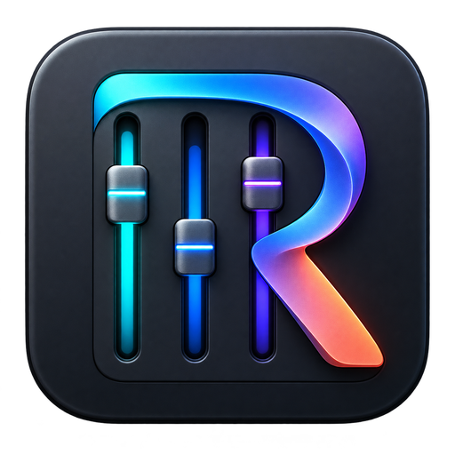
</p>

<h1 align="center">Rustudio</h1>

<p align="center">
  <b>Ton matériel, dans un même espace.</b><br>
  Logiciel libre pour Windows, écrit en Rust, organisé en modules. Modules GoXLR Mini et Attack Shark R5 Ultra.
</p>

<p align="center">
  <a href="https://github.com/samirmedani/rustudio/releases/latest"></a>
  <a href="https://github.com/samirmedani/rustudio/actions/workflows/ci.yml"></a>
  <a href="LICENSE"></a>
  
  
</p>

<p align="center">
  <a href="https://github.com/samirmedani/rustudio/releases/latest"><b>Télécharger Rustudio-Setup.exe</b></a> ·
  <a href="#installer">Installer</a> · <a href="docs/MODULES.md">Ajouter un appareil</a>
</p>

<p align="center">
  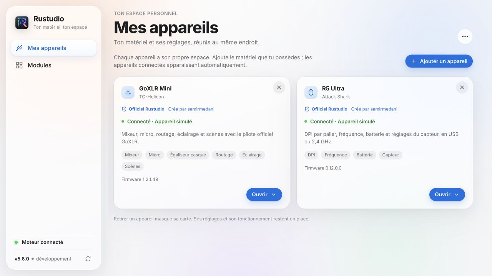
</p>

*Open-source controller for your desk gear on Windows, written in Rust. Devices: the Attack Shark R5 Ultra and TC-Helicon GoXLR Mini,
with the official driver only (mixer, natural voice with optional processing, routing, lighting, scenes,
headphone EQ, echo check, OBS overlay, opt-in updates). Anyone can add a device module. French interface.*

## Pourquoi

Rustudio réunit les réglages de ton matériel dans une seule application. **Mes appareils** est l'accueil : tu y
vois les appareils pris en charge par les modules livrés, leur état et l'accès à leurs réglages. **Modules** présente
le catalogue et les appareils pour lesquels tu peux contribuer.

La version actuelle livre deux modules : **GoXLR Mini** et **Attack Shark R5 Ultra**. Les autres souris, claviers, écrans et la GoXLR complète restent des pistes de contribution ; leur présence au catalogue ne signifie pas qu’ils sont pilotés par Rustudio.
Le module [R5 Ultra](docs/R5-ULTRA.md) règle les paliers DPI X/Y, leur sélection, la fréquence, la veille et le capteur, et affiche la batterie. Les DPI, la fréquence et le délai anti-double clic sont vérifiés sur la vraie souris en 2,4 GHz. Le transport USB est implémenté et testé en simulation ; Bluetooth, macros et remappage des boutons ne sont pas pris en charge.

Les modules sont compilés dans l’application : aucun code du catalogue n’est téléchargé ou installé à la volée.
Les modules officiels indiquent leur créateur ; les modules communautaires conservent leur attribution et
passent par une [PR GitHub analysée et validée](docs/COMMUNITY.md) avant d’apparaître dans une version publiée.

Le moteur tourne en service Windows dès le démarrage et se relance s'il a un souci. Le module GoXLR Mini parle
au pilote officiel de TC-Helicon et reprend l'appareil quand il est rebranché.

## Retrouver ton matériel

1. Ouvre **Mes appareils** : les appareils déjà détectés ou ajoutés gardent leur carte après un débranchement.
   Pour ajouter un appareil hors ligne, passe par **Modules**.
2. Clique sur la carte de ton appareil : **GoXLR Mini** ouvre ses pages audio ; **R5 Ultra** ouvre **Ma souris**.
3. Ouvre **Modules** pour consulter les appareils disponibles ou à contribuer. Seul un module livré et son
   adaptateur matériel permettent de piloter un appareil.

Le menu de l'icône Windows donne aussi accès à **Mes appareils**, **Modules**, puis aux actions de la **GoXLR Mini**
dans son propre sous-menu quand elle est connectée.

<p align="center">
  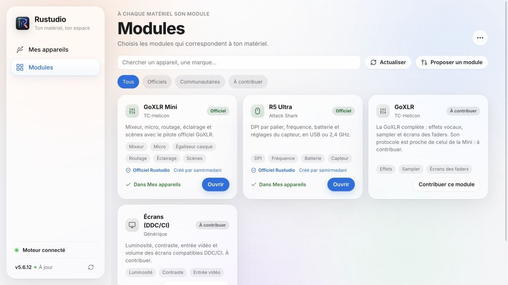
</p>

## Ce que le module R5 Ultra sait faire

- Jusqu’à six paliers DPI, axes X/Y séparés, et choix du palier actif.
- Fréquence, batterie, hauteur de décrochage, délai anti-double clic, veille et options du capteur.
- Relecture des réglages après application ; aucune écriture à la connexion.
- Un fil HID indépendant de l’audio, avec reprise des lectures perdues sur la liaison 2,4 GHz.

<p align="center">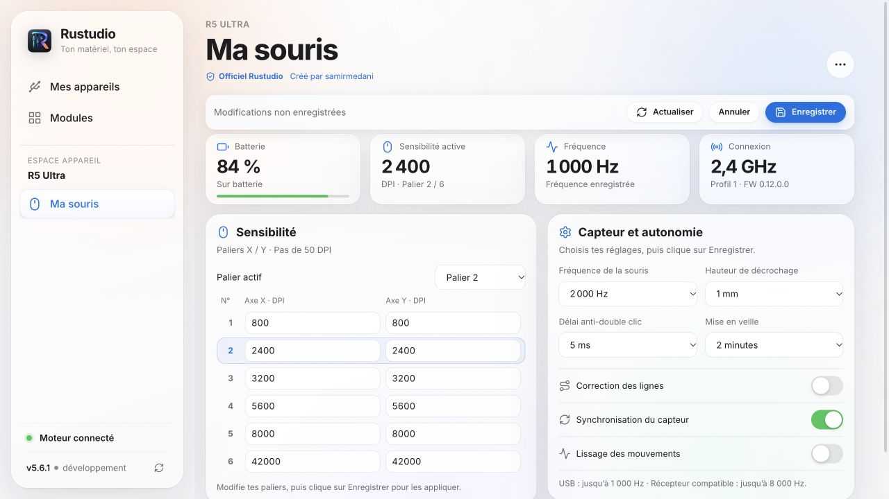</p>

Voir [les fonctions et limites du module](docs/R5-ULTRA.md).

## Ce que le module GoXLR Mini sait faire

<table>
<tr>
<td width="50%">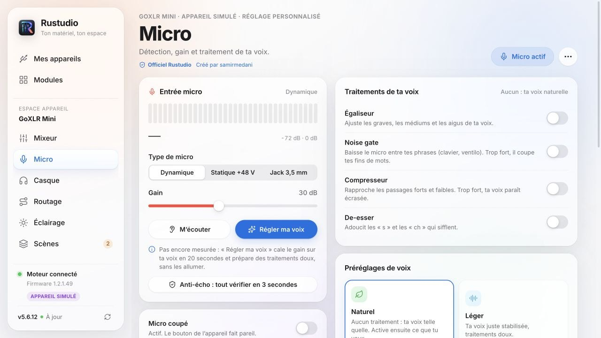</td>
<td width="50%">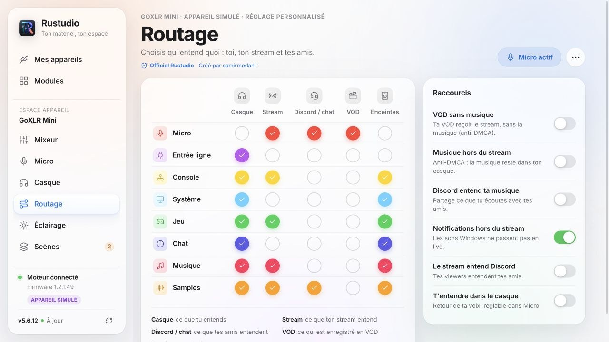</td>
</tr>
<tr>
<td><b>Micro</b> : ta voix naturelle par défaut. Égaliseur, noise gate, compresseur et de-esser ont chacun leur interrupteur. <b>« Régler ma voix »</b> trouve ton micro (48 V compris) et cale le gain en 20 secondes ; « M'écouter » enregistre ta voix et te la fait réécouter.</td>
<td><b>Routage</b> : qui entend quoi (toi, ton stream, Discord, la VOD, les enceintes). <b>VOD sans musique</b> : la VOD reçoit le stream sans la musique, anti-DMCA.</td>
</tr>
<tr>
<td>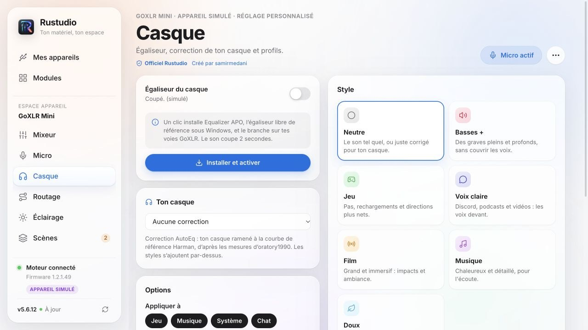</td>
<td>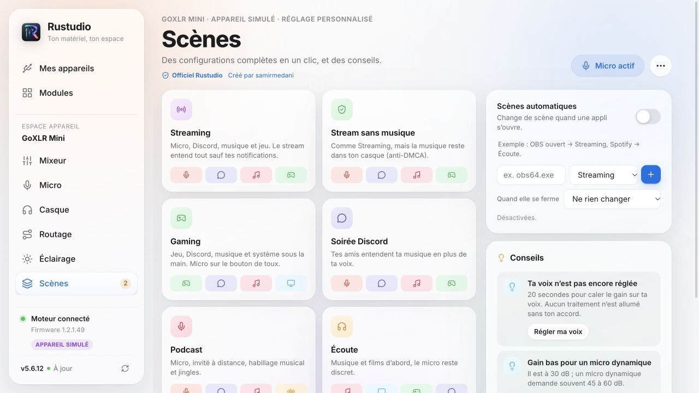</td>
</tr>
<tr>
<td><b>Casque</b> : correction de 21 casques (AutoEq, cible Harman), styles et profils sur 10 bandes, appliqués par Equalizer APO aux voies GoXLR ; coupé tout seul pendant le live.</td>
<td><b>Scènes</b> : Streaming, Gaming, Soirée Discord, Podcast… en un clic, et <b>scènes automatiques</b> : « OBS s'ouvre → Streaming ». Elles ne touchent jamais à ta voix.</td>
</tr>
<tr>
<td>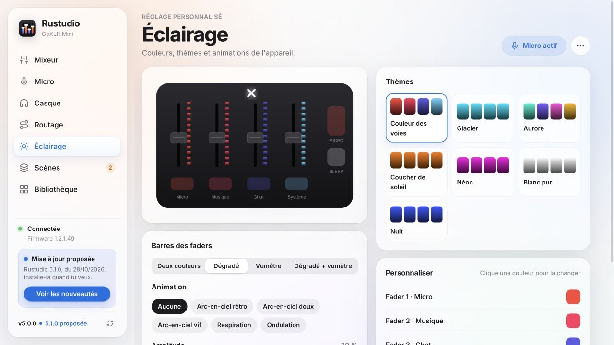</td>
<td>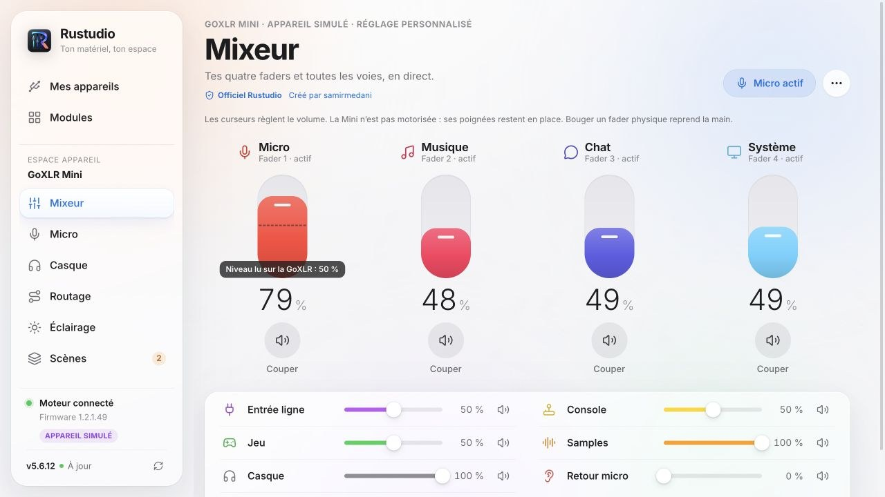</td>
</tr>
<tr>
<td><b>Éclairage</b> : thèmes (les barres prennent la couleur de la voie), couleurs par bouton, styles des barres, animations.</td>
<td><b>Mixeur</b> : quatre faders, toutes les voies et leurs volumes, avec les boutons de coupure par sortie.</td>
</tr>
</table>

- **Couper d'une seule sortie** : chaque bouton mute a son mode (partout, stream, Discord, casque, enceintes).
  Appui long = coupé partout, le bouton clignote.
- **Faders physiques** suivis pendant leur mouvement, sans renvoyer d’anciennes valeurs au matériel ; un pic isolé est filtré.
  La Mini n’est pas motorisée : un réglage à l’écran change le volume, pas la position de sa poignée.
  Le prochain mouvement physique reprend la main.
- **Anti-écho** : tout ce qui peut faire entendre une voix en double est vérifié au même endroit, avec une
  correction en un clic, et un vrai test (trois bips joués dans Discord, ton micro écouté, écho mesuré).
- **Appli Windows** : icône d'état près de l'horloge (rouge = micro coupé), bulle à l'écran quand le micro change
  (jamais de focus, même en jeu), menu rapide, démarrage avec Windows.
- **Incrustation OBS** : « Micro coupé » à l'écran du stream (`http://127.0.0.1:14565/overlay`).
- **Diagnostic** en direct : connexion, commandes, reconnexions, journal ; bouton « Reconnecter ».
- **Son qui crépite ?** Un test fait l'aller-retour d'un son aigu discret entre le PC et la GoXLR, sans que tu
  l'entendes, et écoute chaque voie : coupures USB, coupures notées par Windows (journal allumé par Rustudio),
  saturation de l'égaliseur ou du micro. Verdict en clair, à lancer pendant que tu joues, avec le port USB à
  préférer (relié au processeur, sans hub) quand le son coupe.
  Sans aucun test, Rustudio relit aussi chaque seconde le compteur du pilote qui note chaque milliseconde de son
  perdue sur l'USB : les coupures des dernières 24 heures s'affichent à la seconde près, avec les programmes que
  Windows lançait à ce moment-là.
  Comment ces chiffres sont lus et vérifiés : [docs/DIAGNOSTIC.md](docs/DIAGNOSTIC.md).

<p align="center">
  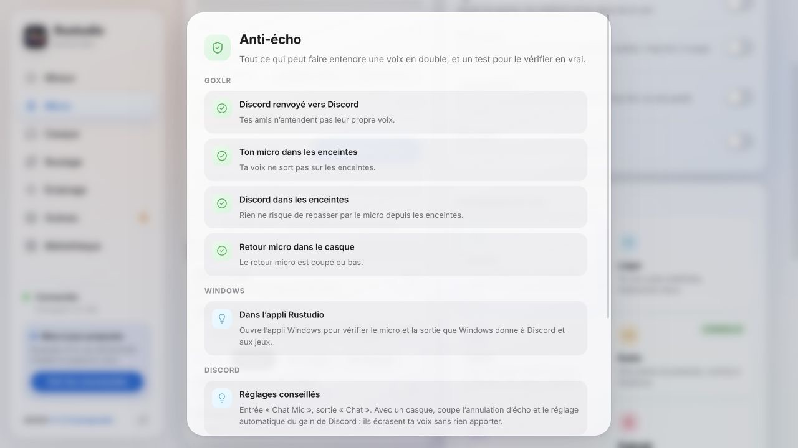
</p>

## Une voix propre, sans écho

1. Dans **Mes appareils › GoXLR Mini › Micro › Régler ma voix** : parle une dizaine de secondes, puis tais-toi.
   Le gain se cale sur ta voix ; aucun traitement ne s'allume. Allume ensuite ceux qui t'aident et vérifie avec **M'écouter**.
2. **Anti-écho** (menu ⋯ ou page Micro) : Rustudio vérifie le routage, le micro que Windows donne à Discord et
   aux jeux (« Chat Mic », jamais « Broadcast Stream Mix »), puis mesure l'écho pour de vrai.
3. **Discord** : micro « Chat Mic », sortie « Chat ». Avec un casque, coupe l'annulation d'écho et le réglage
   automatique du gain de Discord.
4. **OBS** : une seule source audio, « Broadcast Stream Mix » ; ce qui part en live se choisit dans Routage.
5. Branche la GoXLR **toujours sur le même port USB** : sur un autre port, Windows crée de nouveaux périphériques.

## Installer

1. Télécharge **[Rustudio-Setup.exe](https://github.com/samirmedani/rustudio/releases/latest)** et lance-le
   (droits administrateur), puis **Installer**.
2. Ouvre **Mes appareils**. Pour la **GoXLR Mini**, installe le **pilote officiel GoXLR** de TC-Helicon et ferme
   GoXLR Utility ou l'appli officielle : deux logiciels ne peuvent pas piloter la GoXLR en même temps.
3. Ouvre sa carte pour régler ton son. Les appareils indiqués « À contribuer » dans **Modules** demandent
   encore un module ; installer Rustudio ne les rend pas compatibles.

Tu utilisais l'ancien logiciel **GoXLR Mini** ? L'installeur le remplace et reprend tes réglages (voix, scènes,
couleurs, égaliseur). Son bouton « Mettre à jour » permet aussi le passage à Rustudio, avec retour arrière si
Rustudio ne reprend pas l'appareil.

<p align="center">
  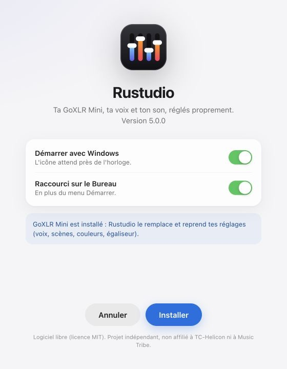
</p>

**Désinstaller** : Paramètres › Applications › Rustudio. Tes réglages restent dans `C:\ProgramData\Rustudio`.

## Mises à jour

<p align="center">
  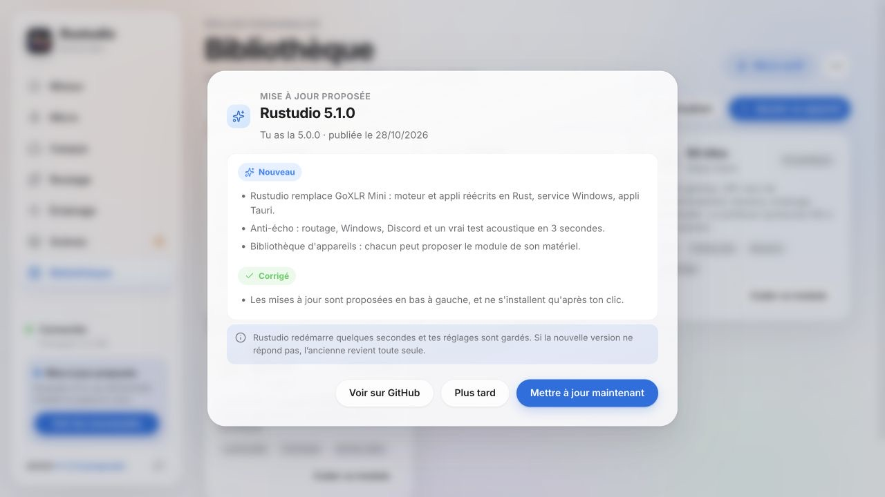
</p>

Rustudio regarde les releases de ce dépôt 5 secondes après le démarrage, puis toutes les 6 heures. Quand une
version sort, **« Mise à jour proposée »** apparaît en bas à gauche : tu lis les nouveautés, puis tu confirmes.
Rien ne s'installe sans ton clic. « Mettre à jour maintenant » :

1. télécharge `Rustudio.zip` **uniquement** depuis les releases de ce dépôt (chaque redirection doit rester chez GitHub) ;
2. compare sa taille et son empreinte **SHA-256** à celles annoncées par GitHub, et vérifie l'archive ;
3. met la version en place de côté, installe la nouvelle et redémarre le service ;
4. si la nouvelle version ne répond pas, **remet l'ancienne** toute seule.

Aucune télémétrie : le seul échange avec Internet est la lecture de la dernière release (et du catalogue de
modules), sans compte ni identifiant, puis le téléchargement que tu as accepté.

## Comment ça marche

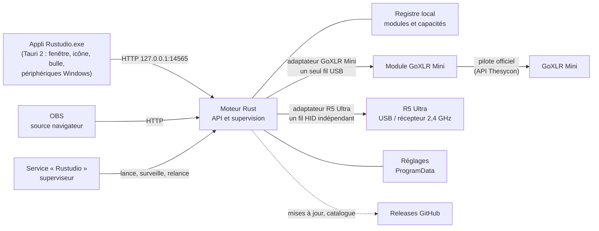

| Crate | Rôle |
| --- | --- |
| `rustudio-core` | Registre des modules et capacités ; état, préréglages et calculs du module GoXLR Mini |
| `rustudio-goxlr` | Protocole USB de la GoXLR Mini (pilote officiel chargé à l'exécution) et fausse GoXLR pour les tests |
| `rustudio-engine` | Service Windows, API locale, états des modules et mises à jour ; adaptateur GoXLR Mini, boucle USB et Equalizer APO |
| `rustudio-app` | Appli Tauri 2 : fenêtre WebView2, icône d'état, bulle, micro et sortie par défaut de Windows |
| `rustudio-attack-shark` | Protocole HID R5 Ultra, transport Windows et simulateur |
| `rustudio-setup` | Installeur en un seul fichier, et passage depuis GoXLR Mini avec retour arrière |

- Dans le module GoXLR Mini, un seul fil parle à l'appareil ; l'API ne l'attend jamais. Toute erreur USB ferme
  la connexion et en rouvre une propre qui réapplique tous tes réglages. Un appel au pilote figé ? Le superviseur relance le moteur.
- L'interface (`ui/index.html`, son code par appareil dans `ui/js`) affiche l'accueil général et les pages des
  modules depuis le registre local.
  L'appli ajoute ce qui demande ta session Windows. `GET /api/modules` expose les modules livrés et l'état de
  leurs appareils ; le catalogue GitHub est consultatif.

## Développer

Tout se code et se teste **sans GoXLR**, grâce à une fausse GoXLR qui imite le pilote et ses pièges
(débranchement, pilote bloqué, compteur de commandes de 16 bits).

```bash
cargo test                                                   # coeur, protocole, moteur, mises à jour
cargo run -p rustudio-engine -- run --child --simulate --port 14566   # puis http://127.0.0.1:14566/
```

Depuis macOS ou Linux, [cargo-xwin](https://github.com/rust-cross/cargo-xwin) fabrique les `.exe` Windows. Une
release se publie en poussant un tag `vX.Y.Z` : GitHub compile tout et, sur une machine Windows de test, joue le
passage depuis la vraie GoXLR Mini 4.8.0 (son updater, un faux GitHub local, reprise des réglages), puis
l'installation complète (service, moteur, appli, désinstallation), avant de publier les fichiers et les notes
tirées de [CHANGELOG.md](CHANGELOG.md). À chaque push, la CI teste aussi la mise à jour intégrée vers une version
suivante. Voir [CONTRIBUTING.md](CONTRIBUTING.md).

## Ajouter un appareil

Le module de ta souris, de ton clavier ou de ton écran reste à écrire ? [docs/MODULES.md](docs/MODULES.md) explique
comment écrire son module, le tester sans l'appareil et le proposer à tous. Un agent de code peut s'en charger :
les règles qu'il doit suivre sont dans [AGENTS.md](AGENTS.md).

## Compatibilité

- **Seul module matériel livré : GoXLR Mini** (firmware 1.2.x testé ; 1.3 pris en charge avec Stream Mix 2).
  La GoXLR complète, les autres souris, les claviers et écrans du catalogue restent à contribuer.
- Windows 10 ou 11, 64 bits, pilote officiel GoXLR, Microsoft Edge WebView2 (présent sur Windows 11).
- Captures faites avec l'appareil simulé.

## Remerciements et licence

Licence **MIT**. Les identifiants des commandes USB viennent du travail de
[goxlr-utility](https://github.com/GoXLR-on-Linux/goxlr-utility) (MIT), les corrections de casques
d'[AutoEq](https://github.com/jaakkopasanen/AutoEq) (MIT). Composants tiers : [THIRD-PARTY-NOTICES.md](THIRD-PARTY-NOTICES.md).

GoXLR est une marque de Music Tribe. Rustudio est un projet indépendant, ni affilié, ni soutenu par TC-Helicon ou
Music Tribe.
