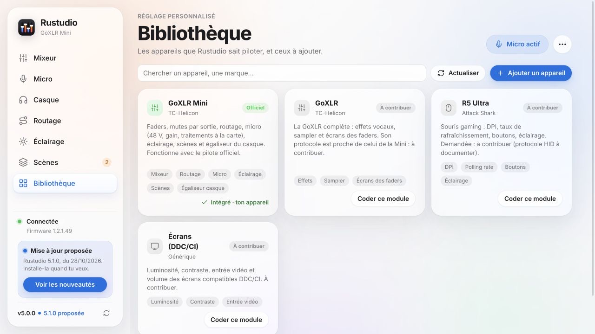
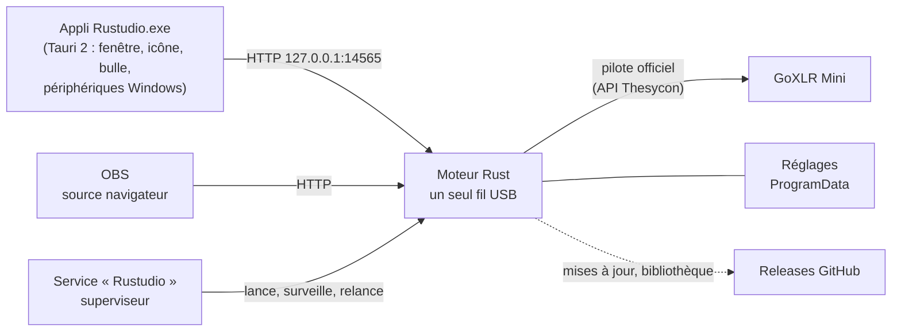

<p align="center">
  
</p>

<h1 align="center">Rustudio</h1>

<p align="center">
  <b>Ta GoXLR Mini, ta voix et ton son, réglés proprement.</b><br>
  Logiciel libre pour Windows, écrit en Rust, qui pilote ton matériel avec le seul pilote officiel.
</p>

<p align="center">
  <a href="https://github.com/samirmedani/rustudio/releases/latest"></a>
  <a href="https://github.com/samirmedani/rustudio/actions/workflows/ci.yml"></a>
  <a href="LICENSE"></a>
  
  
</p>

<p align="center">
  <a href="https://github.com/samirmedani/rustudio/releases/latest"><b>Télécharger Rustudio-Setup.exe</b></a> ·
  <a href="#installer">Installer</a> · <a href="docs/MODULES.md">Ajouter un appareil</a>
</p>

<p align="center">
  
</p>

*Open-source controller for your desk gear on Windows, written in Rust. First device: the TC-Helicon GoXLR Mini,
with the official driver only (mixer, natural voice with optional processing, routing, lighting, scenes,
headphone EQ, echo check, OBS overlay, opt-in updates). Anyone can add a device module. French interface.*

## Pourquoi

La GoXLR se pilote depuis l'ordinateur : sans logiciel, ses boutons ne coupent rien et ses couleurs restent
figées. Rustudio est un moteur qui parle directement au pilote officiel de TC-Helicon, et une appli claire pour tout
régler. Il tourne en service Windows dès le démarrage, se relance seul s'il a un souci et reprend la GoXLR dès
qu'elle est rebranchée.

Rustudio vise plus loin qu'un seul appareil. Chaque matériel est un **module**, et la **bibliothèque** intégrée
liste ceux qui existent et ceux qu'il reste à écrire : souris, claviers, écrans… N'importe qui, ou son agent de
code, peut ajouter le sien par une pull request.

## Ce qu'il sait faire

<table>
<tr>
<td width="50%"></td>
<td width="50%"></td>
</tr>
<tr>
<td><b>Micro</b> : ta voix naturelle par défaut. Égaliseur, noise gate, compresseur et de-esser ont chacun leur interrupteur. <b>« Régler ma voix »</b> trouve ton micro (48 V compris) et cale le gain en 20 secondes ; « M'écouter » enregistre ta voix et te la fait réécouter.</td>
<td><b>Routage</b> : qui entend quoi (toi, ton stream, Discord, la VOD, les enceintes). <b>VOD sans musique</b> : la VOD reçoit le stream sans la musique, anti-DMCA.</td>
</tr>
<tr>
<td></td>
<td></td>
</tr>
<tr>
<td><b>Casque</b> : correction de 21 casques (AutoEq, cible Harman), styles et profils sur 10 bandes, appliqués par Equalizer APO aux voies GoXLR ; coupé tout seul pendant le live.</td>
<td><b>Scènes</b> : Streaming, Gaming, Soirée Discord, Podcast… en un clic, et <b>scènes automatiques</b> : « OBS s'ouvre → Streaming ». Elles ne touchent jamais à ta voix.</td>
</tr>
<tr>
<td></td>
<td></td>
</tr>
<tr>
<td><b>Éclairage</b> : thèmes (les barres prennent la couleur de la voie), couleurs par bouton, styles des barres, animations.</td>
<td><b>Bibliothèque</b> : les appareils pris en charge et ceux à contribuer, avec leur statut (officiel, communautaire, générique).</td>
</tr>
</table>

- **Couper d'une seule sortie** : chaque bouton mute a son mode (partout, stream, Discord, casque, enceintes).
  Appui long = coupé partout, le bouton clignote.
- **Faders physiques** suivis en direct ; une valeur lue une seule fois est ignorée.
- **Anti-écho** : tout ce qui peut faire entendre une voix en double est vérifié au même endroit, avec une
  correction en un clic, et un vrai test (trois bips joués dans Discord, ton micro écouté, écho mesuré).
- **Appli Windows** : icône d'état près de l'horloge (rouge = micro coupé), bulle à l'écran quand le micro change
  (jamais de focus, même en jeu), menu rapide, démarrage avec Windows.
- **Incrustation OBS** : « Micro coupé » à l'écran du stream (`http://127.0.0.1:14565/overlay`).
- **Diagnostic** en direct : connexion, commandes, reconnexions, journal ; bouton « Reconnecter ».
- **Son qui crépite ?** Un test fait l'aller-retour d'un son aigu discret entre le PC et la GoXLR, sans que tu
  l'entendes, et écoute chaque voie : coupures USB, coupures notées par Windows (journal allumé par Rustudio),
  saturation de l'égaliseur ou du micro. Verdict en clair, à lancer pendant que tu joues, avec le port USB à
  préférer (relié au processeur, sans hub) quand le son coupe.
  Sans aucun test, Rustudio relit aussi chaque seconde le compteur du pilote qui note chaque milliseconde de son
  perdue sur l'USB : les coupures des dernières 24 heures s'affichent à la seconde près, avec les programmes que
  Windows lançait à ce moment-là.

<p align="center">
  
</p>

## Une voix propre, sans écho

1. Page **Micro › Régler ma voix** : parle une dizaine de secondes, puis tais-toi. Le gain se cale sur ta voix ;
   aucun traitement ne s'allume. Allume ensuite ceux qui t'aident et vérifie avec **M'écouter**.
2. **Anti-écho** (menu ⋯ ou page Micro) : Rustudio vérifie le routage, le micro que Windows donne à Discord et
   aux jeux (« Chat Mic », jamais « Broadcast Stream Mix »), puis mesure l'écho pour de vrai.
3. **Discord** : micro « Chat Mic », sortie « Chat ». Avec un casque, coupe l'annulation d'écho et le réglage
   automatique du gain de Discord.
4. **OBS** : une seule source audio, « Broadcast Stream Mix » ; ce qui part en live se choisit dans Routage.
5. Branche la GoXLR **toujours sur le même port USB** : sur un autre port, Windows crée de nouveaux périphériques.

## Installer

1. Installe le **pilote officiel GoXLR** de TC-Helicon, et ferme GoXLR Utility ou l'appli officielle :
   deux logiciels ne peuvent pas piloter la GoXLR en même temps.
2. Télécharge **[Rustudio-Setup.exe](https://github.com/samirmedani/rustudio/releases/latest)** et lance-le
   (droits administrateur), puis **Installer**.
3. Tu utilisais **GoXLR Mini** ? L'installeur le remplace et reprend tes réglages (voix, scènes, couleurs,
   égaliseur). Tu peux aussi cliquer « Mettre à jour » dans GoXLR Mini : si Rustudio ne reprend pas ta GoXLR,
   GoXLR Mini revient tout seul.

<p align="center">
  
</p>

**Désinstaller** : Paramètres › Applications › Rustudio. Tes réglages restent dans `C:\ProgramData\Rustudio`.

## Mises à jour

<p align="center">
  
</p>

Rustudio regarde les releases de ce dépôt 5 secondes après le démarrage, puis toutes les 6 heures. Quand une
version sort, **« Mise à jour proposée »** apparaît en bas à gauche : tu lis les nouveautés, puis tu confirmes.
Rien ne s'installe sans ton clic. « Mettre à jour maintenant » :

1. télécharge `Rustudio.zip` **uniquement** depuis les releases de ce dépôt (chaque redirection doit rester chez GitHub) ;
2. compare sa taille et son empreinte **SHA-256** à celles annoncées par GitHub, et vérifie l'archive ;
3. met la version en place de côté, installe la nouvelle et redémarre le service ;
4. si la nouvelle version ne répond pas, **remet l'ancienne** toute seule.

Aucune télémétrie : le seul échange avec Internet est la lecture de la dernière release (et de la liste de la
bibliothèque), sans compte ni identifiant, puis le téléchargement que tu as accepté.

## Comment ça marche



| Crate | Rôle |
| --- | --- |
| `rustudio-core` | État, préréglages, scènes, éclairage, égaliseur du casque : tout ce qui se calcule sans matériel |
| `rustudio-goxlr` | Protocole USB de la GoXLR Mini (pilote officiel chargé à l'exécution) et fausse GoXLR pour les tests |
| `rustudio-engine` | Service Windows, superviseur, boucle USB, API locale, mises à jour, Equalizer APO, désinstallation |
| `rustudio-app` | Appli Tauri 2 : fenêtre WebView2, icône d'état, bulle, micro et sortie par défaut de Windows |
| `rustudio-setup` | Installeur en un seul fichier, et passage depuis GoXLR Mini avec retour arrière |

- Un seul fil parle à l'appareil ; l'API ne l'attend jamais. Toute erreur USB ferme la connexion et en rouvre une
  propre qui réapplique tous tes réglages. Un appel au pilote figé ? Le superviseur relance le moteur.
- L'interface (`ui/index.html`) est une page locale servie par le moteur ; l'appli l'affiche et ajoute ce qui
  demande ta session Windows.

## Développer

Tout se code et se teste **sans GoXLR**, grâce à une fausse GoXLR qui imite le pilote et ses pièges
(débranchement, pilote bloqué, compteur de commandes de 16 bits).

```bash
cargo test                                                   # coeur, protocole, moteur, mises à jour
cargo run -p rustudio-engine -- run --child --simulate --port 14566   # puis http://127.0.0.1:14566/
```

Depuis macOS ou Linux, [cargo-xwin](https://github.com/rust-cross/cargo-xwin) fabrique les `.exe` Windows. Une
release se publie en poussant un tag `vX.Y.Z` : GitHub compile tout et, sur une machine Windows de test, joue le
passage depuis la vraie GoXLR Mini 4.8.0 (son updater, un faux GitHub local, reprise des réglages), puis
l'installation complète (service, moteur, appli, désinstallation), avant de publier les fichiers et les notes
tirées de [CHANGELOG.md](CHANGELOG.md). À chaque push, la CI teste aussi la mise à jour intégrée vers une version
suivante. Voir [CONTRIBUTING.md](CONTRIBUTING.md).

## Ajouter un appareil

Ta souris, ton clavier, ton écran ne sont pas dans la bibliothèque ? [docs/MODULES.md](docs/MODULES.md) explique
comment écrire son module, le tester sans l'appareil et le proposer à tous. Un agent de code peut s'en charger :
les règles qu'il doit suivre sont dans [AGENTS.md](AGENTS.md).

## Compatibilité

- **GoXLR Mini** (firmware 1.2.x testé ; 1.3 pris en charge avec Stream Mix 2). La GoXLR complète est à contribuer.
- Windows 10 ou 11, 64 bits, pilote officiel GoXLR, Microsoft Edge WebView2 (présent sur Windows 11).
- Captures faites avec l'appareil simulé.

## Remerciements et licence

Licence **MIT**. Les identifiants des commandes USB viennent du travail de
[goxlr-utility](https://github.com/GoXLR-on-Linux/goxlr-utility) (MIT), les corrections de casques
d'[AutoEq](https://github.com/jaakkopasanen/AutoEq) (MIT). Composants tiers : [THIRD-PARTY-NOTICES.md](THIRD-PARTY-NOTICES.md).

GoXLR est une marque de Music Tribe. Rustudio est un projet indépendant, ni affilié, ni soutenu par TC-Helicon ou
Music Tribe.
