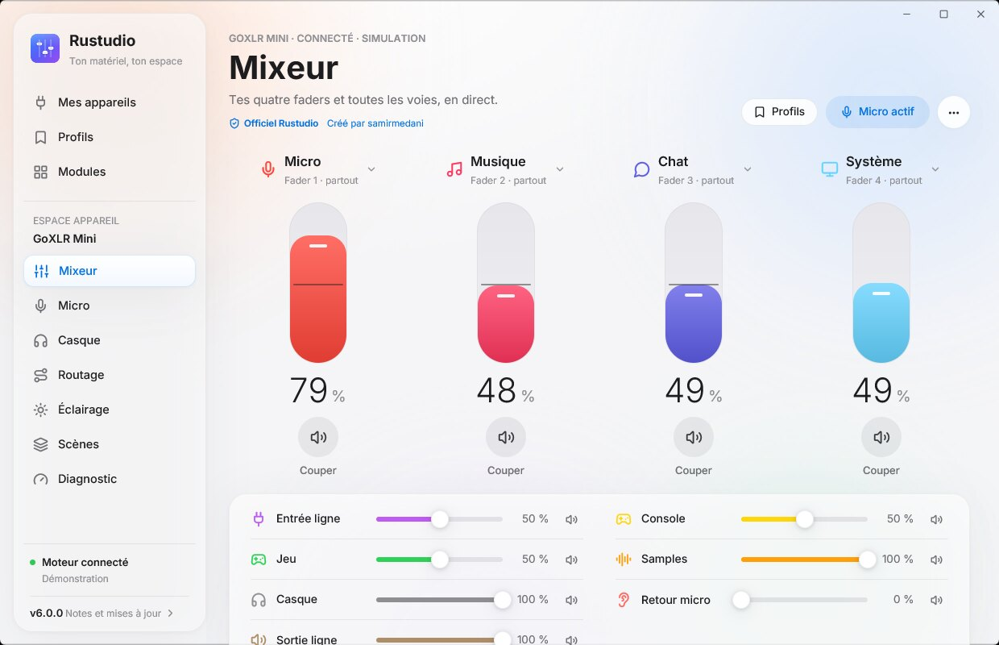

# Module GoXLR Mini

Le module Rustudio prend en charge la **TC-Helicon GoXLR Mini** via le pilote officiel. Le firmware 1.2.x a été testé ; le firmware 1.3 est pris en charge avec Stream Mix 2.

## Démarrer

1. Installe le pilote officiel GoXLR de TC-Helicon.
2. Ferme l’application officielle et GoXLR Utility avant d’ouvrir le module. Un seul logiciel peut piloter la GoXLR à la fois.
3. Branche la Mini, puis ouvre **Mes appareils → GoXLR Mini**. Si possible, utilise toujours le même port USB : Windows peut créer de nouvelles entrées et sorties quand tu changes de port.

| Écran | Réglages |
| --- | --- |
| **Mixeur** | Quatre faders, niveau et coupure par voie. La Mini n’est pas motorisée : le réglage à l’écran ne déplace pas le fader, et son prochain mouvement reprend la main. |
| **Micro** | Type de micro, gain, empreinte vocale et préréglages. Les traitements et le retour micro s’activent seulement à ton choix. |
| **Routage** | Destination de chaque voie : casque, stream, chat, enceintes ou VOD. |
| **Éclairage et scènes** | Couleurs, animations et configurations rappelables manuellement ou à l’ouverture d’une application. |
| **Casque** | Égaliseur à dix bandes, corrections AutoEq et styles d’écoute. |

## Passer de l’ancien logiciel GoXLR Mini à Rustudio

Si tu utilisais GoXLR Mini 4.x, [l’installateur Rustudio](https://github.com/samirmedani/rustudio/releases/latest/download/Rustudio-Setup.exe) peut le remplacer et reprendre tes réglages. Le bouton **Mettre à jour** de l’ancien logiciel reste utilisable : son [pont de migration](https://github.com/samirmedani/goxlr-mini/releases/tag/v5.0.0) est conservé sur le dépôt archivé.

## Voix, chat et OBS

Dans **Micro → Créer mon empreinte**, suis les étapes de mesure pour caler ton gain et calculer des préréglages. Tu peux ensuite comparer la voix brute et traitée. [Détails du réglage de la voix](VOIX.md).

Dans Discord, choisis **Chat Mic** comme entrée et **Chat** comme sortie. **Anti-écho** aide à contrôler le routage et à mesurer un éventuel retour. Pour OBS, utilise le **Stream Mix** (appelé « Broadcast Stream Mix » sur les anciens pilotes) et choisis ce qui part en direct dans **Routage**. La source navigateur `http://127.0.0.1:14565/overlay` affiche l’état du micro.

Si le son craque, ouvre **Son qui crépite ?** dans Rustudio. Le module lit les compteurs de coupures du pilote et propose des tests de diagnostic. [Guide du diagnostic](DIAGNOSTIC.md).

[Retour à Rustudio et aux autres modules](../README.md).
