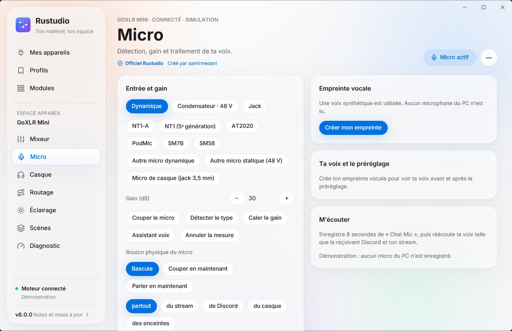

# Empreinte vocale et préréglages sur mesure

Rustudio règle ta voix pour **ton** micro et **ta** pièce : il écoute trente secondes, mesure ce qui fait ta voix,
puis calcule chaque préréglage pour toi. Tout reste sur ton PC. Cette page explique ce qui est mesuré, comment les
réglages sont calculés, et ce que Rustudio sait de l’égaliseur de la GoXLR Mini.

## Créer ton empreinte

Page **Micro** › **Créer mon empreinte**. Trois étapes, guidées à l’écran :

| Étape | Durée | Ce que tu fais | Ce que Rustudio mesure |
| --- | --- | --- | --- |
| Silence | 5 s | Rien, casque et PC comme d’habitude | Le bruit de ta pièce : ventilation, PC, ronflement électrique |
| Lecture | 16 s | Tu lis un texte riche en « s », « ch », « p » et « b » | Ta voix : hauteur, timbre, sifflantes, souffle des « p », écho de la pièce, niveaux |
| Plus fort | 5 s | Une phrase plus forte, comme quand tu t’emportes | Ta marge avant saturation |

Pendant ces trente secondes, les traitements du micro sont contournés, « Chat Mic » ne porte que ta voix et le volume
du micro est au maximum : la mesure porte sur ton micro brut. Si ta voix sature pendant la lecture, le gain baisse de
10 dB et tu relis. À la fin, le gain est calé pour que tes crêtes arrivent vers −12 dB, et que ta phrase forte reste
au moins 3 dB sous la saturation. Tout revient ensuite comme avant.

L’appli Windows enregistre l’entrée « Chat Mic » et l’envoie au moteur local (`127.0.0.1`). Le moteur l’analyse en
mémoire puis l’oublie : **l’enregistrement n’est jamais écrit sur le disque ni envoyé**. Seule l’analyse est gardée
dans `C:\ProgramData\Rustudio\state.json` (des niveaux par bande de fréquences et quelques chiffres). « Oublier »
l’efface.

  

### Ce que l’analyse mesure

- **Spectre de ta voix** : niveau moyen de ta parole par sixième d’octave, de 50 Hz à 16 kHz, sans les pauses ;
  le spectre du silence donne celui du bruit de ta pièce, au même gain.
- **Hauteur** : fondamentale de ta voix (médiane, et ses notes les plus basses et les plus hautes).
- **Sifflantes** : part des « s » et « ch » dans ta parole, combien ils dépassent ta voix, et à quelle fréquence.
- **« p » et « b »** : coups de souffle sous 100 Hz qui frappent la capsule.
- **Ronflement** : 50 ou 60 Hz (secteur) et leurs harmoniques dans le silence.
- **Pièce** : réverbération apparente à la fin des mots (elle mêle l’écho de la pièce et ta distance au micro).
- **Dynamique** : écart entre tes passages calmes et forts, crêtes, saturation.

## Comment les préréglages sont calculés

**La cible.** Ta voix est comparée à un spectre de parole de référence (ANSI S3.5-1997, effort vocal normal),
complété par ce qu’apporte une bonne prise de près : effet de proximité dans les graves, présence de la bouche dans
l’axe. Sous ta fondamentale, il ne devrait rien rester : souffle, chocs et ventilation y sont coupés.

**Chaque préréglage** a une tolérance (l’écart laissé tel quel, pour garder ton timbre), une part de l’écart qu’il
corrige, et sa couleur :

| Préréglage | Tolérance | Couleur | Compresseur | Noise gate |
| --- | --- | --- | --- | --- |
| Léger | large | aucune | doux | seulement si ta pièce est bruyante |
| Studio | moyenne | un peu d’air et de clarté | modéré | doux |
| Broadcast | serrée | chaleur, présence, médiums allégés | marqué | doux |
| Stream | serrée | clarté et présence | marqué | doux |
| Podcast | moyenne | chaleur | modéré | très doux |
| Anti-clavier | moyenne | graves plus légers | marqué | silence complet entre tes phrases |

**Les garde-fous.**

- Pas de remontée sous ta voix, ni là où ta voix n’a presque rien ou se noie dans le bruit de ta pièce : on ne
  monterait que le souffle.
- La correction de ta voix remonte de 3 dB au plus (avec la couleur du préréglage, 6 dB au total) ; l’air au-delà de
  12 kHz, de 2 dB au plus.
- Les sifflantes sont retirées du spectre avant de régler l’égaliseur : c’est le travail du de-esser.
- Là où la mesure est peu sûre (bruit trop proche de ta voix), la courbe publiée de ton micro prend le relais.
  Un micro brillant, comme le NT1-A, voit toujours ses aigus un peu calmés.

**Les six bandes** de la Mini sont ensuite réglées pour reproduire au mieux la courbe visée : toutes les fréquences
permises (par vingt-quatrièmes d’octave) et tous les gains entiers sont essayés, bande après bande, jusqu’à ce que
plus rien ne s’améliore. Une bande qui n’apporte presque rien reste à plat.

**Le reste.**

- **De-esser** : selon le dépassement de tes sifflantes, plus fort avec un micro brillant ou des aigus remontés.
- **Noise gate** : seuil entre le bruit de ta pièce et tes passages calmes, réduction juste suffisante pour rendre
  le bruit inaudible (silence complet pour Anti-clavier).
- **Compresseur** : ratio selon ta dynamique, seuil sous ton niveau moyen, compensation limitée pour que ta phrase
  forte ne sature pas.

Chaque réglage est expliqué à l’écran, et « Écouter et comparer » bascule en direct (60 s au plus) entre ta voix
traitée et ta voix brute.

## L’égaliseur réel de la GoXLR Mini

L’égaliseur du micro de la Mini a six bandes. Leur fréquence se règle dans une plage (celles de l’appli officielle),
leur gain de −9 à +9 dB. Leur forme a été **mesurée sur une vraie Mini** : un signal stable (le souffle propre de
l’entrée jack, gain 40 dB) traverse l’égaliseur, chaque réglage est comparé à des références à plat intercalées,
2 à 4 fois, et les courbes obtenues sont comparées à des modèles de filtres.

| Bande | Plage | Forme mesurée | Particularité |
| --- | --- | --- | --- |
| 90 Hz | 30–90 Hz | plateau grave du second ordre, Q ≈ 0,94 | moitié de l’effet à la fréquence choisie, plein effet une octave dessous |
| 250 Hz | 100–300 Hz | cloche, Q ≈ 1,38 | juste, réglages graves compris |
| 500 Hz | 310–800 Hz | cloche, Q ≈ 1,32 | juste |
| 1 kHz | 800–2 500 Hz | cloche, Q ≈ 1,48 | juste |
| 3 kHz | 2,6–5 kHz | cloche, Q ≈ 1,35 | juste |
| 8 kHz | 5,1–18 kHz | plateau aigu, Q ≈ 0,96 | juste sur toute la plage |

Chaque bande tombe sur la fréquence demandée (à 3 % près), coupe autant qu’elle remonte, et son gain suit le
réglage. Le modèle suit les mesures à 1 dB près en moyenne, l’écart restant étant celui de la mesure elle-même
(1,6 dB vers 100 Hz, 0,5 dB vers 1 kHz). La courbe affichée dans l’onglet Égaliseur et les préréglages sur mesure
utilisent ce modèle.

## Micros connus

Les chiffres viennent des fiches officielles. Le gain de départ vaut 57 dB pour un SM7B, moins pour un micro plus
sensible ; l’empreinte le recale ensuite sur ta voix.

| Micro | Type | Sensibilité | Bruit propre | Gain de départ | Fiche |
| --- | --- | --- | --- | --- | --- |
| RØDE NT1-A | statique, 48 V | 25 mV/Pa | 5 dB(A) | 30 dB | [rode.com](https://rode.com/en-us/products/nt1a) |
| RØDE NT1 (5ᵉ génération) | statique, 48 V | 25 mV/Pa | 4 dB(A) | 30 dB | [fiche](https://edge.rode.com/pdf/products/1184/NT1%205th%20GEN_Datasheet.pdf) |
| Audio-Technica AT2020 | statique, 48 V | 14,1 mV/Pa | 20 dB SPL | 35 dB | [fiche](https://docs.audio-technica.com/us/at2020_submit.pdf) |
| RØDE PodMic | dynamique | 1,6 mV/Pa | — | 54 dB | [fiche](https://edge.rode.com/pdf/products/108/PodMic_Datasheet_FA.pdf) |
| Shure SM7B | dynamique | 1,12 mV/Pa | — | 57 dB | [guide](https://pubs.shure.com/view/guide/SM7B/en-US.pdf) |
| Shure SM58 | dynamique | 1,85 mV/Pa | — | 53 dB | [fiche](https://pubs.shure.com/file/260009) |

Ton micro n’y est pas ? Choisis « Autre micro dynamique », « Autre micro statique » ou « Micro de casque » :
l’empreinte fait l’essentiel. Pour l’ajouter au catalogue, ouvre une pull request sur
[crates/core/src/mics.rs](../crates/core/src/mics.rs) avec le lien de sa fiche officielle.

## Limites

- Une empreinte vaut pour le micro avec lequel elle a été faite : change de micro, refais-la.
- Refais-la aussi si tu changes de place, de pièce ou de distance au micro.
- L’analyse travaille sur ta parole lue : une voix chantée ou criée longtemps se comporte autrement.
